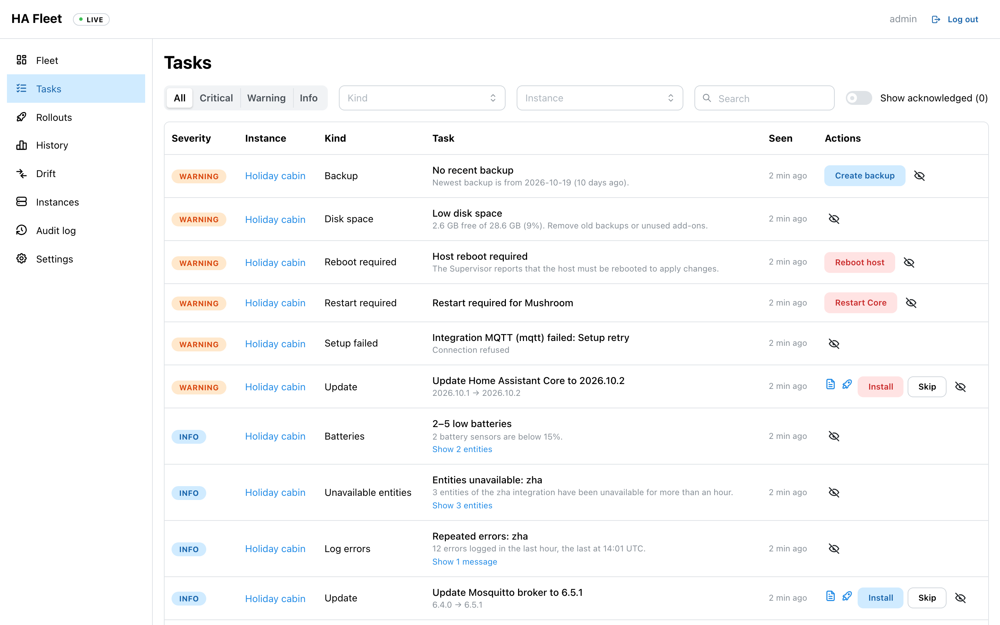
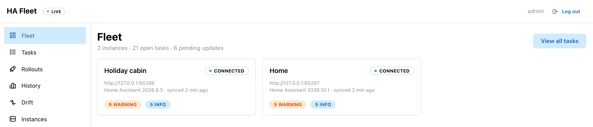
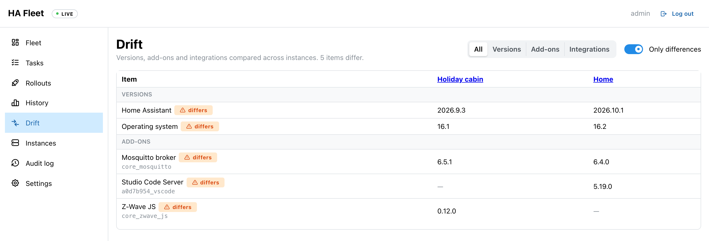

# hafleet: Home Assistant fleet manager

hafleet shows everything that needs attention across several Home Assistant instances on one page, and lets you act on it.



| Fleet overview | Drift between instances |
|---|---|
|  |  |

Screenshots use the demo data from `make fakeha`.

It detects the following kinds of tasks:

| Task | Source | Action |
|---|---|---|
| Pending updates: Core, OS, Supervisor, add-ons, HACS, integrations | `update.*` entities | Install (with optional backup), Skip |
| Repair issues | `repairs/list_issues` | Link to docs |
| Restart required (for example after a HACS install) | Repair issues | Restart Core (checks config first on Supervisor installs) |
| Host reboot required | Supervisor resolution center | Reboot host |
| Unhealthy or unsupported system | Supervisor resolution center | — |
| Integrations that failed to set up, pending re-authentication | Config entries and flows | — |
| No recent backup | `backup/info` | Create backup |
| Instance unreachable | hafleet itself | — |
| Low disk space (below the disk threshold, default 15%; critical below 5% or 2 GB) | Supervisor `/host/info` | — |
| TLS certificate expires within 21 days (critical within 7, or expired) | the TLS handshake | — |
| 3 or more entities of one integration unavailable for over an hour | `get_states` + entity registry | — |
| Batteries below the battery threshold (default 15%) | `get_states` (`device_class: battery`) | — |
| An integration logged 5 or more errors in the last hour | `system_log/list` | — |

Every check except updates and connectivity can be switched off on the **Settings** page (admins), together with the disk, battery and backup-age thresholds. An instance can override each of these in its own settings ("Check overrides"); unset values inherit from the Settings page, which in turn falls back to the command-line flags. A switched-off check creates no tasks, its open History entries are closed, and data that only it needs is not fetched (for example the entity registry for unavailable entities, `system_log/list` for log errors, Supervisor `/host/info` for disk space). Config entries are always fetched because the Drift page needs the integration list. Changes are written to the audit log and every instance resyncs right away.

**Rollouts** install one update across several instances, one at a time. Start one with the rocket icon on an update task that more than one instance offers:
- Choose the instances and their order, how many go first as **canaries**, a **health check** period (default 15 minutes), an optional start time, and whether to back up first.
- For each instance, hafleet installs the update through the normal action (same allowlist, same audit log, recorded as user `rollout:<name>`), waits until the instance reports the new version, and then watches it for the health check period. A critical task that was not there before the install (including the instance becoming unreachable) fails the step.
- A failed step **pauses** the rollout; it never continues on its own. **Resume** retries the failed step, **Skip** moves on without it, **Cancel** ends the rollout. Pause and cancel take effect between instances: an install that Home Assistant already started cannot be stopped.
- An instance's **maintenance window** (instance settings, e.g. `02:00-05:00` in the server's time zone) limits when a rollout may update it.
- An instance can only be part of one active rollout. If hafleet restarts during an install, that step is marked failed and the rollout paused, so you can check the instance first.

The **History** page shows how tasks develop over time: tasks open per day by severity, opened vs. resolved, time to resolve per kind, and tasks that keep coming back. A task only counts as resolved once the source that reports it was read successfully, so a failed fetch or an unreachable instance does not close anything. Closed entries are kept for a year.

The **Drift** page compares instances side by side: Home Assistant, Supervisor and OS versions, installed add-ons, and loaded integrations. When most instances share a value, the instances that differ are highlighted; when there is no majority (for example two instances that differ), the row is marked instead. Supervisor and OS versions and add-ons come from the Supervisor API (`/info`, `/addons`) and are only available on Home Assistant OS and Supervised installs.

hafleet is a single Go binary with the React UI embedded. It keeps one WebSocket connection open to each instance and resyncs everything every 10 minutes. Update changes arrive live, and the browser gets updates over Server-Sent Events.

## Quick start

```sh
make build                                   # builds web UI + bin/hafleet
export HAFLEET_SECRET_KEY=$(bin/hafleet genkey)   # store this safely, see "Security"
bin/hafleet admin create admin               # prompts for a password (min. 12 chars)
bin/hafleet serve -tls-cert cert.pem -tls-key key.pem
```

Then open the UI, go to **Instances → Add instance**, and enter:

- the base URL of the instance, for example `https://ha.example.com:8123`
- a long-lived access token, created in Home Assistant under *Profile → Security*

Use **Test connection** to check the settings before saving.

To run without TLS, put hafleet behind an HTTPS reverse proxy. For local testing over plain HTTP, pass `-secure-cookies=false`.

### Docker

```sh
mkdir -p data && openssl rand -hex 32 > data/hafleet.key
docker compose up -d --build
docker compose exec -e HAFLEET_ADMIN_PASSWORD='…' hafleet /hafleet admin create admin
```

### Proxmox (LXC container)

`make proxmox` builds an LXC template in `dist/`. It is based on Proxmox's official Alpine template, which is downloaded and checksum-verified on the first run, and adds hafleet as an OpenRC service that starts at boot. Set `PROXMOX_ARCH=arm64` for ARM hosts.

```sh
make proxmox
scp dist/hafleet-*-alpine-*_amd64.tar.gz root@pve:/var/lib/vz/template/cache/

# on the Proxmox host
pct create 120 local:vztmpl/hafleet-<version>-alpine-3.24_amd64.tar.gz \
  --hostname hafleet --unprivileged 1 --memory 256 --rootfs local-lvm:2 \
  --net0 name=eth0,bridge=vmbr0,ip=dhcp --onboot 1 --start 1
pct exec 120 -- hafleet-admin create admin
pct exec 120 -- hafleet-admin create alice operator   # optional: viewer, operator or admin
```

Then open `http://<container-ip>:8080`.

- **Settings:** `/etc/hafleet/hafleet.env`. Apply changes with `rc-service hafleet restart`.
- **Logs:** `/var/log/hafleet.log`.
- **Secret key:** generated on the first start in `/etc/hafleet/secret.key`. Back it up together with `/var/lib/hafleet`.
- **HTTPS:** the container serves plain HTTP with non-Secure cookies. For HTTPS, use a reverse proxy, or set `HAFLEET_TLS_CERT`/`HAFLEET_TLS_KEY` in the env file.

## Configuration

Each flag can also be set through the environment variable in the second column.

| Flag | Env | Default | |
|---|---|---|---|
| `-listen` | `HAFLEET_LISTEN` | `:8080` | |
| `-data-dir` | `HAFLEET_DATA_DIR` | `./data` | SQLite database |
| `-secret-key` / `-secret-key-file` | `HAFLEET_SECRET_KEY` / `HAFLEET_SECRET_KEY_FILE` | required | 32 bytes, hex or base64 |
| `-tls-cert`, `-tls-key` | `HAFLEET_TLS_CERT`, `HAFLEET_TLS_KEY` | — | Turns on HTTPS and HSTS |
| `-secure-cookies` | `HAFLEET_SECURE_COOKIES` | `true` | |
| `-allowed-origins` | `HAFLEET_ALLOWED_ORIGINS` | — | Extra allowed `Origin` values |
| `-resync-interval` | `HAFLEET_RESYNC_INTERVAL` | `10m` | |
| `-backup-max-age` | `HAFLEET_BACKUP_MAX_AGE` | `168h` | Default; can be changed on the Settings page |
| `-disk-free-min` | `HAFLEET_DISK_FREE_MIN` | `15` | Percent free disk space below which a task is created. Default; can be changed on the Settings page |
| `-battery-min` | `HAFLEET_BATTERY_MIN` | `15` | Battery level in percent below which a sensor is reported. Default; can be changed on the Settings page |
| `-metrics-token` | `HAFLEET_METRICS_TOKEN` | — | Enables `/metrics`; at least 16 characters |

### Prometheus metrics

Set a metrics token to enable `GET /metrics`. Scrapers authenticate with `Authorization: Bearer <token>`; without a token the endpoint does not exist.

```yaml
scrape_configs:
  - job_name: hafleet
    scheme: https
    authorization:
      credentials_file: /etc/prometheus/hafleet-token
    static_configs:
      - targets: ["hafleet.example.com"]
```

| Metric | Type | Labels |
|---|---|---|
| `hafleet_instance_up` | gauge | `instance_id`, `instance` |
| `hafleet_instance_info` | gauge (1) | `instance_id`, `instance`, `ha_version` |
| `hafleet_last_sync_timestamp_seconds` | gauge | `instance_id`, `instance` |
| `hafleet_tasks` | gauge | `instance_id`, `instance`, `kind`, `severity`, `acknowledged` |
| `hafleet_actions_total` | counter | `action`, `result` |
| `hafleet_ai_requests_total` | counter | `feature` (only with AI enabled) |
| `hafleet_ai_tokens_total` | counter | `feature`, `type` (`input`, `output`, `cache_read`, `cache_write`) |

The metrics contain instance names and versions, never URLs or tokens. Counters restart at zero when hafleet restarts.

### Status entities in Home Assistant

hafleet can show its view of an instance inside that instance, as entities on a "hafleet" device. Each instance only receives its own data.

1. Install the **hafleet** integration from [home-assistant-fleet-hass](https://github.com/schmidtfx/home-assistant-fleet-hass) through HACS (custom repository) and add it under Settings → Devices & services. Pick the Home Assistant user whose token hafleet uses; the instance form in hafleet shows its user ID.
2. In hafleet, edit the instance and turn on **Publish status to Home Assistant**. The token must belong to an admin user.

The integration creates an open-tasks sensor, a last-sync timestamp, a connection sensor, and one problem binary sensor per task kind (for example "Backup stale"). Acknowledged tasks do not count as open. The entities keep their state across Home Assistant restarts and become unavailable when hafleet has not reported for 15 minutes.

How it works: hafleet fires a `hafleet_status` event over its existing WebSocket connection when the instance's tasks change, and at least every 5 minutes. The integration ignores events from any other user. Home Assistant needs no access to hafleet. The event contains task kinds, severities and titles (at most 20 per kind), counts, warnings and the last sync time. Home Assistant's recorder stores events, so these titles end up in its database. When publishing is turned off or the instance is removed, hafleet sends a final `enabled: false` event and the entities become unavailable.

## AI features (optional)

AI is off by default. When it is enabled, hafleet adds these features:

- **Update risk review:** reads the release notes and flags only the breaking changes that affect integrations this instance actually uses. The result appears as a risk badge on the task, in the install confirmation dialog, and in the release-notes drawer.
- **Explain:** gives the likely cause and fix steps for repairs, failed integrations, re-auth and unhealthy tasks.
- **Briefing:** a summary on the dashboard of what is urgent across the fleet, with a suggested order of work. It also uses the last 30 days of task history, for example to point out problems that keep coming back.
- **Assistant:** a chat that answers questions about the fleet, including task history, rollouts and drift. It can *propose* actions, which show up as the normal confirmation button. It cannot start or control rollouts.
- **Post-update health check:** after an update was installed, the AI looks at the tasks that appeared since and at recent error log messages, and says whether the update probably broke something (`ok`, `suspect` or `broken`). Run it from a rollout step (**AI check**), or turn on **Also ask the AI** when starting a rollout: a `suspect` or `broken` verdict, or a failed check, then pauses the rollout. The AI can only stop a rollout, never continue one; instances without AI enabled skip the check.

The model never receives Home Assistant tokens, never calls Home Assistant, and never runs anything. Every action still needs your confirmation and goes through the allowlist and audit log.

```sh
# Claude (Anthropic API). Uses ANTHROPIC_API_KEY.
HAFLEET_AI_PROVIDER=anthropic bin/hafleet serve ...

# Local model through Ollama
HAFLEET_AI_PROVIDER=ollama HAFLEET_OLLAMA_MODEL=<model> bin/hafleet serve ...
```

After starting hafleet with a provider, turn on **Enable AI features** for each instance in its settings. Instances without it are never sent to a model.

| Flag | Env | Default | |
|---|---|---|---|
| `-ai-provider` | `HAFLEET_AI_PROVIDER` | — | `anthropic` or `ollama`; empty disables AI |
| `-ai-model` | `HAFLEET_AI_MODEL` | `claude-opus-5-5` | Claude model |
| `-ai-effort` | `HAFLEET_AI_EFFORT` | `medium` | Claude effort: `low` … `max` |
| `-ai-fallbacks` | `HAFLEET_AI_FALLBACKS` | `true` | Claude server-side refusal fallbacks |
| `-ai-limit` | `HAFLEET_AI_CHAT_LIMIT` | `60` | AI requests per user per hour |
| `-ai-auto-review` | `HAFLEET_AI_AUTO_REVIEW` | `false` | Review new updates in the background |
| `-ollama-url` | `HAFLEET_OLLAMA_URL` | `http://localhost:11434` | |
| `-ollama-model` | `HAFLEET_OLLAMA_MODEL` | — | Required for Ollama |
| `-ollama-num-ctx` | `HAFLEET_OLLAMA_NUM_CTX` | `32768` | Larger inputs are rejected, never truncated |

**What is sent to the model:**
- **Sent:** instance names, Home Assistant versions, integration domains, and task titles and details. For the briefing and the assistant also task history (counts per kind, time to resolve, titles of recurring tasks), rollout states, and add-on names and versions. For the post-update health check, the error log messages of the affected integrations (redacted, at most 50, each cut to 500 characters). For the health tasks only counts, percentages and the integration domain are sent: the entity IDs of low batteries and unavailable entities, and the logged error messages, are shown in the UI but never sent. For update reviews, the release notes too: from Home Assistant, or fetched from `home-assistant.io` or `github.com` only.
- **Removed first:** the instance URL, the location name, IP addresses, private hostnames (`*.local`, `*.duckdns.org`, …), email addresses, and every URL that is not a public documentation page.
- **Location name caveat:** any text that matches the location name is also redacted, so give instances names that differ from it.

**Cost control:**
- Results are cached in SQLite per update version and set of integrations, so each release is reviewed once per instance.
- The Claude system prompt is cached.
- Every model call logs its token usage as an `ai usage` line.

**Refusal fallbacks (Claude):**
- When enabled, a request that Claude declines for policy reasons is retried by a fallback model inside the same call.
- To turn this off, set `HAFLEET_AI_FALLBACKS=false`.

## Security

**Home Assistant tokens**
- Tokens are encrypted at rest with AES-256-GCM.
- Each token is bound to its instance ID, so an encrypted token cannot be copied to another row.
- Tokens are never returned by the API or written to logs.
- If you lose the secret key, all stored tokens become unreadable and must be entered again.
- Recommendation: create a dedicated Home Assistant **admin** user for hafleet on each instance. Admin rights are needed for repairs, Supervisor data and actions. You can then revoke its token on its own if you need to.

**TLS to Home Assistant**
- Certificates are verified against the system trust store by default.
- For each instance you can instead:
  - trust a custom CA by pasting its PEM, or
  - pin the leaf certificate's SHA-256 fingerprint, for self-signed certificates.
- Plain `http://` is only accepted if you explicitly allow it for that instance.

To get a certificate's fingerprint:

```sh
openssl s_client -connect ha.local:8123 </dev/null 2>/dev/null | openssl x509 -noout -fingerprint -sha256
```

**Users and roles**
- Each user has a role. Each role includes the rights of the one before it:
  - `viewer`: sees everything, changes nothing, and does not use AI features that call the model.
  - `operator`: also runs actions, acknowledges tasks, refreshes instances and uses the AI features.
  - `admin`: also adds, changes and removes instances.
- `hafleet admin create <user> -role operator` creates a user with a role. The default role is `admin`; users from earlier versions are admins.
- `hafleet admin role <user> <role>` changes a role and revokes that user's sessions.
- Roles are checked by the server on every request. The UI only hides controls a role cannot use.

**hafleet login**
- Passwords are hashed with argon2id.
- Sessions are stored server-side, with `HttpOnly`, `SameSite=Strict` and `Secure` cookies.
- Write requests require a CSRF token and pass an Origin check.
- After 5 failed logins from the same IP and username, login is blocked for 15 minutes.
- `hafleet admin passwd <user>` changes a password and revokes that user's sessions.

**Actions**
- Only the actions a task lists are allowed. There is no generic service-call passthrough.
- The UI asks for confirmation before running an action.
- Every action is written to the audit log twice: when it is submitted and when it finishes.
- Adding, changing and removing instances is also written to the audit log (name only, never the URL or token).

## Development

```sh
make dev       # Go backend on :8080 + Vite on http://localhost:5173
make fakeha    # fake Home Assistant with demo data (prints URL + token)
make test      # go vet, go test -race, tsc, vitest
```

To test against a real Home Assistant instead of the fake one, run `docker compose --profile dev up homeassistant`. It starts Home Assistant with the `demo` integration.

### Layout

```
cmd/hafleet        CLI: serve, admin, genkey
cmd/fakeha         fake Home Assistant for local development
internal/hass      Home Assistant WebSocket client (+ hasstest fake server)
internal/fleet     per-instance connection workers and live snapshots
internal/tasks     Home Assistant data → normalized tasks
internal/actions   allowlisted actions and audit logging
internal/rollout   rollouts: one update across instances, canaries, health gate, maintenance windows
internal/ai        AI features: Claude/Ollama providers, redaction, review, explain, briefing, chat
internal/api       REST + SSE API, security headers, embedded SPA
internal/auth      login, sessions, CSRF, rate limiting
internal/store     SQLite persistence
internal/secrets   AES-GCM token encryption
web/               React + Vite + Mantine UI
```
